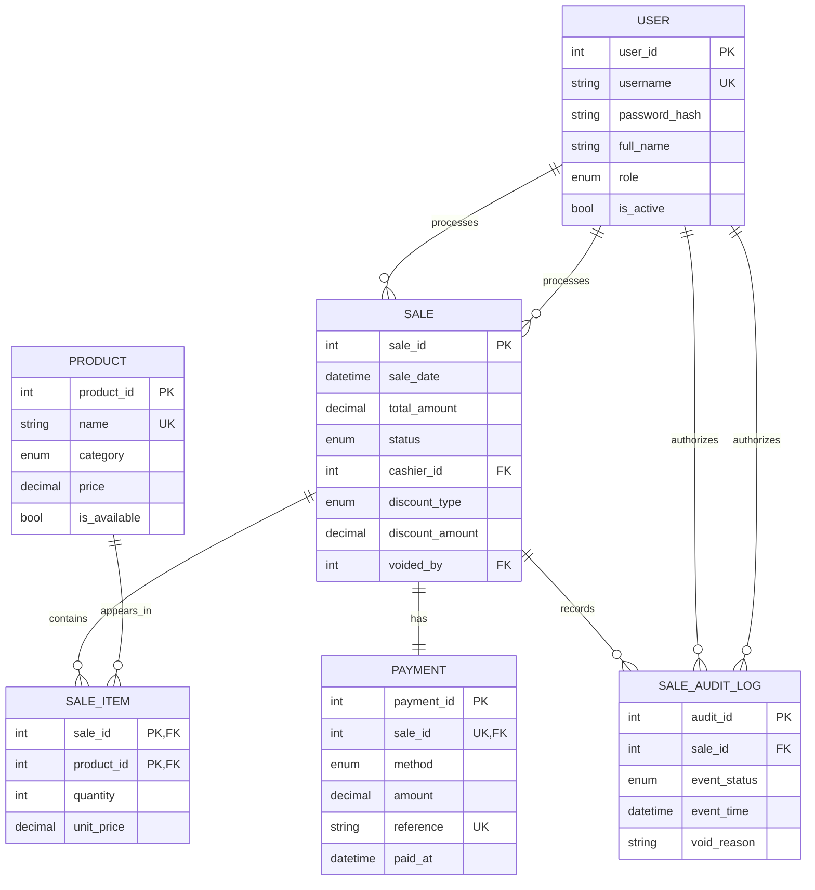

# 21 GRIDS — IMFDB ERD

## Important cardinalities

- One User/Cashier can process many Sales; each sale has one cashier.
- One Sale contains many Sale Items; one Product can appear in many sale items. This resolves the Sale–Product M:N relationship.
- One Sale has exactly one Payment. The `UNIQUE` constraint on `payments.sale_id` enforces this.
- One Sale can have multiple Audit Log events, allowing the original Completed event to remain when a later Void event is recorded.
